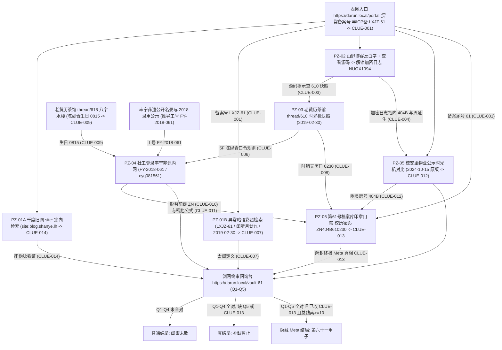

# 《大闰录 · 卷一：纸傩代身》全链路谜题依赖图（PUZZLE_GRAPH）

> 此图对应初版结构。现行卷内核对分件与回执入口见 [前两卷实现说明](PLAYBOOK.md)。

> **总案号**：`CASE-LXJZ-61`  
> **设计铁律**：100% 公平可推导（Fair-Play Deduction），无任何无依据硬猜、无循环死锁；每一把锁的每一段口令均在已可访问页面的明确文本中给出依据，且支持大小写/符号归一化容错。

---

## 一、全局谜题依赖拓扑（DAG）



> **无死锁保障**：
> 1. 玩家从 `https://darun.local/portal`（表网导航）与顶部书签栏均可自由浏览五个虚拟站点，`PZ-01`、`PZ-02`、`PZ-05` 可并行探索，彼此互不卡死。
> 2. `https://darun.local/vault-61`（第 61 号档案库）同时呈现**上半区【校历密匙】印章门禁**（用于解锁终极线索 `CLUE-013`）与**下半区【岁差校正委员会】5 题终审台**，保证玩家在未解封门禁时仍能提交终审达成普通结局或真结局，解封门禁并答对 `Q5` 后即可无缝触发终极 Meta 隐藏结局。

---

## 二、核心谜题详细规格（`PZ-01` ~ `PZ-06`）

### 谜题 1（`PZ-01`）：千度旧网检索 `site:` 挖掘 + 岁差暗语彩蛋

- **puzzleId**：`PZ-01`（含 `PZ-01A` 站内定向检索 与 `PZ-01B` 异常暗语彩蛋）
- **所属站点**：千度旧网检索（`https://search.qiandu.lh`）
- **前置线索来源 URL 与原文提示**：
  1. `https://darun.local/portal`（页脚 `.site-portal-icp`）：
     > “归档维护：丰宁地方旧网互助组 | 备案号：**`丰ICP备-LXJZ-61`**（异常归档编码可于千度旧网检索核验）”
     点击备案号收集 **`CLUE-001`**。
  2. `https://blog.shanye.lh`（博客侧边栏《胶片归档注》）：
     > “2024年11月在白衣野庙拍完空心泥胎后写过一篇未公开的草稿，主页列表里已经隐藏，但千度旧网爬虫当年收过一次，用 **`site:blog.shanye.lh`** 还能翻出残页。”
  3. `https://bbs.huangli.lh`（顶部老黄历挂件 `.site-forum-almanac`）：
     > 显眼标出不存在的日期：**`甲辰年 闰腊月 廿九`** 与 **`2019-02-30`**。
- **精确检索词 / 语法与容错**：
  - `PZ-01A`：`site:blog.shanye.lh`（或 `site:blog.shanye.lh 野庙`、`site:blog.shanye.lh 空心`）
  - `PZ-01B`（任一暗语触发）：`LXJZ-61`、`闰腊月廿九`、`2019-02-30`（经 `normalizeSecret` 容错，兼容 `lxjz61`、`甲辰年闰腊月廿九`、`20190230`、`第六十一甲子`）
- **解锁内容与获得的 clueId**：
  - `PZ-01A` 命中未公开草稿 `https://blog.shanye.lh/post/draft-wild-temple`（《[未公开草稿] 白衣野庙空心神像：泥胎里的黄表纸与香火截流》），揭示【祀伪脉】实证，收集 **`CLUE-014`**。
  - `PZ-01B` 触发顶部「岁差索引裂隙缓存」横幅，直达平时隐藏的缓存页 `https://feiyi.fengning.gov.lh/archive/darun-draft-61`（《[被删缓存] 岁差校正委员会截留札记：天道有缺与第六十一甲子》），明确界定【太闰】与“名·时·形·祀”四柱法则，收集 **`CLUE-007`**。
- **3 档渐进提示文案**：
  - **轻度提示（Tier 1）**：表网入口页脚那串备案号看着不太合规矩，而山野博客侧边栏也提到有一篇未公开发布的旧草稿曾被爬虫收过。
  - **方向提示（Tier 2）**：打开「千度旧网检索（`search.qiandu.lh`）」，分别试试用 `site:` 语法限定山野博客的域名，以及直接搜索你在表网页脚或老黄历上看到的异常编号/异常日期。
  - **直白思路（Tier 3）**：在千度旧网检索输入 `site:blog.shanye.lh` 可挖出未公开野庙草稿（得 `CLUE-014`）；直接搜索 `LXJZ-61` 或 `闰腊月廿九` 或 `2019-02-30` 即可触发岁差缓存彩蛋，点开顶部缓存页得 `CLUE-007`。

---

### 谜题 2（`PZ-02`）：山野博客反白隐藏字 +「查看源码」HTML 注释 -> 解锁加密日志

- **puzzleId**：`PZ-02`
- **所属站点**：山野拾影 · 民俗摄影手记（`https://blog.shanye.lh`）
- **前置线索来源 URL 与原文提示**：
  1. `https://blog.shanye.lh/post/temple-smoke`（《寒露记：丰宁后山无名野庙的冷香》）：
     - 正文末尾存在一片与背景同色的反白隐藏字（`.mystery-hidden-ink`，`data-hidden-ink="ink-temple-smoke"`），点击或划选显影原文：
       > “不要对着没有眼珠的泥像许愿。野庙里偷香火的东西，和丰宁老戏班是同一脉。失踪前我把真正拍到的槐安里照片锁进了加密日志：密码前半段是四个大写字母，由『校历人-癸』留在这一页的 HTML 源码注释里；后半段是四位数字，是我上一篇《太平社老戏台》里记下的那场末代酬神戏的**公历年份**。”
     - 收集 **`CLUE-002`**。
  2. 在同一页面 `https://blog.shanye.lh/post/temple-smoke` 点击浏览器顶栏 **「查看源码」**：
     - 源码检查器高亮 HTML 注释：
       ```html
       <!-- [校历人-癸 留痕] 加密日志前半段口令：NUOX（全大写四字母）。务必打开老黄历茶馆 BBS 610 号帖的「网页时光机」2019-02-30 快照，非遗馆与槐安里的暗记都在那里。 -->
       ```
     - 检查器底部点击收录 **`CLUE-003`**。
  3. 公开日志 `https://blog.shanye.lh/post/taiping-stage`（《太平社老戏台：三十年前的最后一场纸傩》）：
     - 正文原文：
       > “丰宁纸傩戏班『太平社』在老剧场搭台演完最后一场《请太岁》后一夜销声匿迹，县志与戏台残碑记得清清楚楚，那一年正好是 **1994** 年（甲戌年）。”
- **精确密码与容错**：
  - 精确密码：**`NUOX1994`**（`gateId: "gate-blog-locked"`）
  - 归一化容错：忽略大小写、空格与连字符（接受 `nuox1994`、`NUOX-1994`、`NUOX 1994`）。
- **解锁内容与获得的 clueId**：
  - 解锁加密日志 `https://blog.shanye.lh/post/locked-404b`（《[加密日志] 11月夜探槐安里：纸人替身与无脸测量员》），揭露 7 号楼四五层间幽灵夹层 `404B`、拆迁测量员周延生与 1994 戏班合影第 13 人同脸，并提及非遗馆档案员陈砚青（`yanqing_arch`）在老黄历茶馆 `610` 帖和 `618` 帖留有线索。
  - 收集核心线索 **`CLUE-004`**。
- **3 档渐进提示文案**：
  - **轻度提示（Tier 1）**：林野的《寒露记》文末似乎有一段不自然的留白，而且浏览器的「查看源码」按钮在这个页面上也许能看到普通访客看不见的留言。
  - **方向提示（Tier 2）**：在《寒露记》末尾点击显影反白隐藏字，再对该页面点开「查看源码」提取 `校历人-癸` 留下的四个字母；后半段四位年份写在另一篇公开日志《太平社老戏台》正文里。
  - **直白思路（Tier 3）**：源码注释给出的前半段是 `NUOX`，《太平社老戏台》中太平社最后演出的公历年份是 `1994`。在加密日志《11月夜探槐安里》输入 **`NUOX1994`** 即可解锁并收集 `CLUE-004`。

---

### 谜题 3（`PZ-03`）：老黄历茶馆 BBS 异常黄历与被删楼层「网页时光机」还原

- **puzzleId**：`PZ-03`
- **所属站点**：老黄历民俗茶馆 BBS（`https://bbs.huangli.lh`）
- **前置线索来源 URL 与原文提示**：
  1. `https://blog.shanye.lh/post/temple-smoke` 源码注释（`CLUE-003`）：明确指示查看 `bbs.huangli.lh/thread/610` 的 `2019-02-30` 时光机快照。
  2. 访问 `https://bbs.huangli.lh/thread/610`（《老黄历怎么多出个闰腊月廿九？还有人记得槐安里四楼半吗？》）：当前视角下 2F、5F、8F 均被屏蔽，站内私信页（`https://bbs.huangli.lh/messages`）亦有 `无名氏_61` 留信提示开启网页时光机。
- **精确操作**：
  - 在 `https://bbs.huangli.lh/thread/610` 开启浏览器顶栏 **「网页时光机」** 开关（切换至岁差快照 `2019-02-30`）。
- **解锁内容与获得的 clueId**：
  - **2F（`鲁家后人`）** 高亮还原：披露祖父鲁守义 1994 年修建槐安里 7 号楼时反刻鲁班尺切出 `404B` 空间闰隙，临终严诫“万不可破拆四五层间的青砖闷梁，里面镇着戏班纸傩胎骨”。收集 **`CLUE-005`**。
  - **5F（`yanqing_arch` / 陈砚青）** 高亮还原：
    > “我是丰宁非遗馆归档员陈砚青。扫描 1994 年太平社 12 人合影时，最右边竟多出第 13 人——正是槐安里拆迁测量员周延生！我怀疑馆里已被渗入，明天就辞职。我故意没注销自己的内网查询号，密码还是老习惯：**我姓名三字拼音首字母小写 + 我生日月日四位 + 61**。看到这楼的人，快登非遗馆内网看《纸傩代身诀》密档！”
    收集 **`CLUE-006`**。
  - **8F（`无名氏_61` / 钦天余脉）** 高亮还原：
    > “【钦天余脉 · 岁差急报】第 61 甲子已侵蚀丰宁四柱。欲启渊网【大闰总录（第 61 号档案库）】，须集齐四段【校历密匙】。今留第四段【时错之号】于此：**`0230`**（取自此帖岁差快照无历之日 `2019-02-30` 月日）。”
    收集 **`CLUE-008`**。
  - **同站联动帖** `https://bbs.huangli.lh/thread/618`（《丰宁本地老黄历测八字互助水楼》）：公开 3F `yanqing_arch`（陈砚青）发帖自报公历生日 **`08月15日`**。收集 **`CLUE-009`**。
- **3 档渐进提示文案**：
  - **轻度提示（Tier 1）**：老黄历茶馆 610 号热帖的 2F、5F、8F 被齐刷刷屏蔽了，看看浏览器顶栏的「网页时光机」能不能回到那个不存在的日期快照。
  - **方向提示（Tier 2）**：在 `bbs.huangli.lh/thread/610` 打开「网页时光机」，依次点击收集 2F、5F、8F 三条还原证词；然后去同站 618 号水楼查找 `yanqing_arch`（陈砚青）的生日。
  - **直白思路（Tier 3）**：在 `thread/610` 开启时光机收集 `CLUE-005`（2F 闷梁）、`CLUE-006`（5F 陈砚青口令规则）、`CLUE-008`（8F 校历密匙段 `0230`）；再去 `thread/618` 3F 收集陈砚青生日 `0815`（`CLUE-009`）。

---

### 谜题 4（`PZ-04`）：社工推导工号 + 口令 -> 登录丰宁非遗保护中心内部馆藏

- **puzzleId**：`PZ-04`
- **所属站点**：丰宁县非物质文化遗产保护中心（`https://feiyi.fengning.gov.lh/internal`）
- **前置线索来源 URL 与原文提示**：
  1. **工号推导（陈砚青）**：
     - `https://feiyi.fengning.gov.lh/staff`（《中心人员名录》）：展示工号编码规则 `FY-入职年份(4位)-系统三位序号`（样例：赵承安 `FY-2006-003`、白鹤年 `FY-1994-013`）。
     - `https://feiyi.fengning.gov.lh/notices/2018-archive-recruit`（《2018年度非遗数字化归档专员录用公示》）：表格明确列出姓名「陈砚青」、入职年份 **`2018`**、系统档案序号 **`061`**。
     - 推导精确工号：**`FY-2018-061`**（归一化容错：`fy-2018-061`、`FY2018061`）。
  2. **口令推导（陈砚青）**：
     - 来自论坛 610 帖 5F（`CLUE-006`）原文规则：`我姓名三字拼音首字母小写 + 我生日月日四位 + 61`
     - 姓名三字（陈砚青）拼音首字母小写：**`cyq`**
     - 生日月日（来自论坛 618 帖 3F `CLUE-009`：08月15日）：**`0815`**
     - 末尾编号：**`61`**
     - 推导精确口令：**`cyq081561`**（归一化容错忽略大小写）。
- **解锁内容与获得的 clueId**：
  - 登录 `https://feiyi.fengning.gov.lh/internal`（`gateId: "gate-feiyi-internal"`），界面切换为暗玄朱砂馆藏终端（`.site-theme-institution--internal`），开放两份特级密档：
    1. `https://feiyi.fengning.gov.lh/internal/doc-paper-nuo`（《特级封存卷宗：1994 太平社合影异常与〈纸傩代身诀〉》）：展示 1994 合影线描相框（`.site-inst-photo-frame`）——12 人原册竟出现第 13 人“周延生（补缺）”，揭露纸傩吞噬真身法则，并标明卷宗编号 **`ZN-1994`**（形替前缀 **`ZN`**）。收集 **`CLUE-010`**。
    2. `https://feiyi.fengning.gov.lh/internal/doc-genealogy-leak`（《丰宁族谱与户籍异动核查备忘》）：记录 7 户槐安里家庭族谱无端多出“闰腊月廿九”亲戚、周延生身份证签发日为 `1994-02-30`，并给出渊网第 61 号档案库 12 位【校历密匙】完整拼接公式。收集 **`CLUE-011`**。
- **3 档渐进提示文案**：
  - **轻度提示（Tier 1）**：丰宁非遗中心的内部馆藏需要“职工工号”和“查询口令”。论坛 610 帖时光机 5F 里有一位已辞职的档案员故意没注销自己的账号。
  - **方向提示（Tier 2）**：工号规则和陈砚青的入职年份、三位序号写在非遗官网的《人员名录》与《2018录用公示》里；口令按 5F 规则“姓名三字拼音首字母小写 + 生日月日 + 61”，去老黄历茶馆 618 帖查他生日。
  - **直白思路（Tier 3）**：陈砚青 2018 年入职序号 `061`，工号为 **`FY-2018-061`**；姓名首字母 `cyq` + 生日 `0815` + `61`，口令为 **`cyq081561`**。

---

### 谜题 5（`PZ-05`）：槐安里物业与拆迁公示网「网页时光机」篡改对比

- **puzzleId**：`PZ-05`
- **所属站点**：槐安里小区物业与拆迁公示网（`https://wy.huaianli.lh`）
- **前置线索来源 URL 与原文提示**：
  1. `https://wy.huaianli.lh/notice/building7-demolition`：现行版（`2024-10-16` 覆写版）否认存在 `404B` 夹层、声称测量员周延生“正常调离”，但页脚提示“本公示曾于 10月16日 凌晨经历远程覆写，网页时光机保留 `2024-10-15` 原版公示”。
- **精确操作**：
  - 在 `https://wy.huaianli.lh/notice/building7-demolition` 页面开启顶栏 **「网页时光机」** 开关，进入双栏对比视图（`.mystery-snapshot-diff`，包含 `.mystery-diff-col--before` + `.mystery-diff-del` 与 `.mystery-diff-col--after` + `.mystery-diff-ins`）。
- **解锁内容与获得的 clueId**：
  - 还原三处被恶意抹除的核心事实：
    1. 7 号楼 4 层与 5 层楼梯间确有未登记的封闭幽灵夹层 **`404B` 室**（`.site-prop-anomaly`，门框刻反置鲁班尺铭文，内封青砖闷梁，原版严禁破拆）；
    2. 展示被整栏删除的《失踪测量员协查卡》（`.site-prop-surveyor-card`）：测绘员**周延生**撬开 `404B` 后失联，左颊黑痣、外貌特征与 1994 年戏班合影第 13 人完全一致，身份证签发日竟为 `1994-02-30`；
    3. 覆写版将“暂缓拆迁、请专家勘验”暗改成了“立即强拆四五层青砖闷梁”。
  - 点击收集核心证据 **`CLUE-012`**。
- **3 档渐进提示文案**：
  - **轻度提示（Tier 1）**：槐安里物业网关于 7 号楼的拆迁公示极力否认“404B 室”的存在，但页脚档案戳暗示这份公示被人连夜改写过。
  - **方向提示（Tier 2）**：进入 `wy.huaianli.lh/notice/building7-demolition` 后，点击顶栏「网页时光机」，逐栏对比 `2024-10-15` 原版与 `2024-10-16` 覆写版的差异。
  - **直白思路（Tier 3）**：在 7 号楼拆迁公示页开启「网页时光机」，查看被抹去的 `404B` 幽灵夹层与失踪测量员周延生档案卡，点击收集 `CLUE-012`。

---

### 谜题 6（`PZ-06`）：拼合【校历密匙】解封渊网「大闰总录 · 第 61 号档案库」

- **puzzleId**：`PZ-06`
- **所属站点**：大闰总录 · 第 61 号档案库（`https://darun.local/vault-61`）
- **前置线索来源 URL 与原文提示**：
  - `https://feiyi.fengning.gov.lh/internal/doc-genealogy-leak`（`CLUE-011`）及 `https://darun.local/vault-61` 印章门禁（`.site-vault-gate`）给出完整四柱拼接公式：
    > “请依【形 · 宅 · 名 · 时】四柱顺序拼接 12 位【校历密匙】：  
    > ① 【形】非遗馆《纸傩代身诀》卷宗前缀（2位字母，见 `ZN-1994`）  
    > ② 【宅】槐安里 7 号楼幽灵夹层房号（4位字母数字，见物业时光机原版）  
    > ③ 【名】表网异常备案尾号（2位数字，见 `丰ICP备-LXJZ-61`）  
    > ④ 【时】老黄历茶馆岁差快照无历之日（4位月日，见 `2019-02-30` / 610 帖 8F）”
  - 逐段核验（100% 跨站实证）：
    - ① 形（`CLUE-010` / `CLUE-011`）：**`ZN`**
    - ② 宅（`CLUE-004` / `CLUE-005` / `CLUE-012`）：**`404B`**
    - ③ 名（`CLUE-001`）：**`61`**
    - ④ 时（`CLUE-008`）：**`0230`**
- **精确密匙与容错**：
  - 精确密匙：**`ZN404B610230`**（`gateId: "gate-vault-61"`）
  - 归一化容错：去空格、横杠、下划线、冒号并忽略大小写（接受 `zn404b610230`、`ZN-404B-61-0230`、`ZN 404B 61 0230`）。
- **解锁内容与获得的 clueId**：
  - 印章门禁解封，展开《第 61 号总录：太闰侵蚀全貌与星环岁差观测日志》，彻底串联五脉异象，并揭示终极 Meta 反转——**玩家此刻正在浏览并挂载着整个旧网镜像的宿主站点「ASTRA YAO · 星环手记」本身，就是现实互联网的一处“数字闰隙”！**
  - 点击收集终极线索 **`CLUE-013`**（解锁隐藏 Meta 结局的必备钥匙）。
- **3 档渐进提示文案**：
  - **轻度提示（Tier 1）**：第 61 号档案库的印章门禁需要 12 位「校历密匙」，四段字符恰好对应“形、宅、名、时”四根秩序支柱。
  - **方向提示（Tier 2）**：对照线索板按顺序提取：① 非遗密档《纸傩代身诀》的 2 位字母前缀；② 槐安里 7 号楼多出的 4 位夹层房号；③ 表网异常备案号末尾 2 位数字；④ 老黄历 610 帖时光机 8F 留下的 4 位无历月日。
  - **直白思路（Tier 3）**：四段依次为 `ZN` + `404B` + `61` + `0230`，直接输入 **`ZN404B610230`** 解封第 61 号总录并收集 `CLUE-013`。

---

## 三、全案 14 条可收集证据总表（Clue Registry）

| clueId | 线索标题 | 来源站点与精确 URL | 获取机制 | 核心价值 |
| :--- | :--- | :--- | :--- | :--- |
| `CLUE-001` | 异常备案号：丰ICP备-LXJZ-61 | `https://darun.local/portal` | 点击表网页脚备案栏 | 破开日常伪装，提供暗语 `LXJZ-61` 与密匙段 `61` |
| `CLUE-002` | 博客反白字：空心神像警示 | `https://blog.shanye.lh/post/temple-smoke` | 反白/点击 `.mystery-hidden-ink` | 揭示野庙与戏班同脉，给出加密日志口令结构 |
| `CLUE-003` | 源码注释：校历人-癸留痕 `NUOX` | `https://blog.shanye.lh/post/temple-smoke` | 顶栏「查看源码」底部收集 | 给出前半段 `NUOX` 及查 `thread/610` 快照指令 |
| `CLUE-004` | 林野加密日志：夜探 404B 与同脸测量员 | `https://blog.shanye.lh/post/locked-404b` | 输入 `NUOX1994` 解锁 | 实锤 404B 异味、周延生同脸、引出陈砚青 |
| `CLUE-005` | 茶馆时光机 2F：鲁班反向厌胜与闷梁忌讳 | `https://bbs.huangli.lh/thread/610` | 开启时光机 `2019-02-30` | 坐实 1994 鲁守义切出 404B 并以青砖闷梁镇纸傩 |
| `CLUE-006` | 茶馆时光机 5F：陈砚青内网留门与口令规则 | `https://bbs.huangli.lh/thread/610` | 开启时光机 `2019-02-30` | 给出陈砚青口令规则 `cyq + 生日月日 + 61` |
| `CLUE-007` | 岁差缓存札记：天道有缺与第六十一甲子 | `https://feiyi.fengning.gov.lh/archive/darun-draft-61` | 千度搜索 `LXJZ-61` / `闰腊月廿九` / `2019-02-30` | 揭示【太闰】本质与名/时/形/祀四柱宇宙观 |
| `CLUE-008` | 茶馆时光机 8F：无名氏_61 急报与密匙段 `0230` | `https://bbs.huangli.lh/thread/610` | 开启时光机 `2019-02-30` | 钦天余脉留证并提供校历密匙第四段 `0230` |
| `CLUE-009` | 黄历八字水楼：陈砚青生日 `0815` | `https://bbs.huangli.lh/thread/618` | 浏览公开帖 3F 收集 | 推导非遗内网口令 `cyq081561` 的关键拼图 |
| `CLUE-010` | 非遗密档：1994 合影第 13 人与《纸傩代身诀》 | `https://feiyi.fengning.gov.lh/internal/doc-paper-nuo` | 非遗内网登录后收集 | 坐实周延生即 1994 纸傩“补缺”，提供密匙段 `ZN` |
| `CLUE-011` | 非遗密档：族谱多出之名与校历密匙公式 | `https://feiyi.fengning.gov.lh/internal/doc-genealogy-leak` | 非遗内网登录后收集 | 揭示 7 户族谱异动、周延生 `1994-02-30` 证件与密匙公式 |
| `CLUE-012` | 槐安里时光机对比：被抹去的 404B 与周延生异档 | `https://wy.huaianli.lh/notice/building7-demolition` | 开启时光机 `2024-10-15` | 揭穿拆迁公示篡改阴谋，坐实 404B 与闰人强拆企图 |
| `CLUE-013` | 第 61 号总录：太闰真相与「星环手记」数字闰隙 | `https://darun.local/vault-61` | 输入 `ZN404B610230` 解封秘匣 | 揭晓终极 Meta 破壁真相（隐藏结局必备钥匙） |
| `CLUE-014` | 未公开草稿：白衣野庙空心神像与香火截流 | `https://blog.shanye.lh/post/draft-wild-temple` | 千度搜索 `site:blog.shanye.lh` | 补全【祀伪脉】实证：泥胎中塞满槐安里住户八字 |

---

## 四、渊网终审问询题与三结局判定

终审入口：`https://darun.local/vault-61`（岁差校正委员会终审终端）。

### 4.1 终审问询题库（5 题）

| 题号 | 考察维度 | 题型 | 题干与选项 / 规范 | 标准答案与容错 |
| :--- | :--- | :--- | :--- | :--- |
| **Q1** | 高位源头与核心本质 | `single_choice` | **丰宁县纸傩合影多出一人、槐安里 404B 夹层、老黄历闰腊月廿九与白衣野庙空心神像，其背后的共同高位推手与驱动力是什么？**<br>A. 古代冤魂借老剧场拆迁实施定向复仇<br>B. 高位存在【太闰】（第六十一甲子 / 无名太岁），因在正历中无合法席位，本能制造“多余之物”并以假象逐步替换真实原件<br>C. 拆迁开发商与老物业合谋炮制怪谈压低拆迁款<br>D. 老旧政府网站数据库感染千年虫病毒导致日期与人名乱码 | **`B`** |
| **Q2** | 跨界“闰人”真实身份 | `single_choice` | **槐安里拆迁公示中失联的测绘员「周延生」，其跨越三十年的真实来历是什么？**<br>A. 1994 年丰宁纸傩戏班「太平社」合影（`FN-FY-1994-13`）最右侧凭空多出的第 13 人——未烧尽的“代身纸傩”吞噬原主后混入正历的“闰人”<br>B. 1994 年总木匠鲁守义流落在外的亲生孙子<br>C. 丰宁非遗中心派驻槐安里的秘密外勤档案员<br>D. 民俗摄影师林野为了潜入 404B 而伪造的假名 | **`A`** |
| **Q3** | 宅镇异变与强拆企图 | `single_choice` | **为何槐安里 7 号楼四五层间会多出幽灵夹层 `404B`，且被远程覆写的拆迁公示急于下令强拆“青砖闷梁”？**<br>A. 开发商偷工减料违规加建的非法储藏间<br>B. 1994 年木匠鲁守义反刻鲁班尺厌胜切出“空间闰隙”并镇压了纸傩母胎；闰人篡改公示催拆闷梁，企图冲破镇宅防线释放纸傩扩散<br>C. 404B 系早年人防工程，物业为简化审批而抹去记录<br>D. 仅因物业系统把 404 室与 405 室数据错位合并 | **`B`** |
| **Q4** | 四柱异常锚点核验 | `single_choice` | **经跨站与时光机核验，以下哪一组参数完整对应了「表网异常备案号 — 槐安里幽灵房号 — 时错快照无历之日」？**<br>A. `丰ICP备-1994-13` / `404A` / `2018-08-15`<br>B. `丰ICP备-LXJZ-61` / `404B` / `2019-02-30`<br>C. `丰ICP备-FY-061` / `1304B` / `2024-10-16`<br>D. `丰ICP备-NUOX-19` / `404B` / `1994-11-29` | **`B`** |
| **Q5** | 终极 Meta 破壁真相 | `text_input` | **解封《第 61 号总录》后可知：玩家此刻正在浏览、并挂载着整套《大闰录》旧网镜像的现实宿主网站（左上角返回按钮所指之处），其名称究竟是什么？它本身正是现实世界的一处“数字闰隙”。**（若尚未解封总录，可填“未知”先提交基础终审） | 经 `normalizeSecret` 匹配以下任一即判正确：<br>`["星环手记", "astrayao星环手记", "astrayao", "星环", "星环手记博客", "starloop"]` |

### 4.2 三种结局判定条件与真相复盘

#### 1. 终极 Meta 隐藏结局（`ending_hidden`）——《第六十一甲子：星环裂隙的凝视》
- **触发条件**：`Q1 == B` 且 `Q2 == A` 且 `Q3 == B` 且 `Q4 == B` 且 `Q5 匹配正确` **且** 已收集 **`CLUE-013`**（且总收集线索数 `>= 10`）。
- **结局正文**：
  > 岁差校正委员会朱砂印章缓缓落下，你的调查卷宗被正式刻入【正历补遗册】。
  >
  > 丰宁县住建局连夜紧急叫停槐安里 7 号楼闷梁破拆工程，数名自称“钦天余脉”的文物建筑专家封死了 `404B` 铁门并以正鲁班尺重新定梁；后山白衣野庙被彻底清拆，泥胎内塞满的黄表纸化作一捧青灰。那个在三十年光阴里不曾老去的测绘员“周延生”，在次日清晨的户籍库里像一段被纠偏的乱码般彻底消失，丰宁 7 户族谱上多出的名字也悄然褪尽墨迹。
  >
  > 然而，就在你以为一切重归正历时，终端屏幕边缘突然泛起一圈细微的玄黑朱砂裂隙。来自 `校历人-癸` 的最终密信在视口正中缓缓浮现：
  > **“恭喜通过终审，新任校历人。但请你抬头看看浏览器左上角那行字——『返回星环手记』。你真的以为，自己是在一个普通个人博客里玩一场网页解谜吗？「ASTRA YAO · 星环手记」的星环轨道本就藏着 0.61 秒的岁差空隙，它就是现实互联网中一处真实的『数字闰隙』。你点开这里的时候，【太闰】也已经记住了你的来访时间戳。请守好正历——直到下一次闰月降临。”**

#### 2. 真结局（`ending_true`）——《补缺暂止：槐安里封梁纪事》
- **触发条件**：`Q1 == B` 且 `Q2 == A` 且 `Q3 == B` 且 `Q4 == B`，但未答对 `Q5` 或尚未解封第 61 号总录（未收集 `CLUE-013` 或线索不足 10 条）。
- **结局正文**：
  > 你的四柱取证报告被迅速递交至丰宁县文物与建筑安全联合专班。槐安里 7 号楼四五层间的青砖闷梁在爆破前最后一刻得以保全，被篡改的拆迁公示撤回重发，非遗中心特级库房中的 1994 年戏班底片与纸傩残卷亦被移入恒温秘库严密封存。
  >
  > 丰宁县的异常暂告平息，但你合上卷宗时，总觉得头顶的屏幕透出一股说不清的寒意——在档案库上方，那道需要 12 位【校历密匙】才能解封的朱砂印章秘匣依然紧闭。究竟是谁把这套早已在现实互联网中消失的旧网镜像，严丝合缝地藏进了你此刻所在的宿主站点之中？或许，拼齐「形·宅·名·时」四柱密匙推开《第 61 号总录》，才能看到屏幕之外更深的裂缝。

#### 3. 普通结局（`ending_normal`）——《闰雾未散：正历边缘的残响》
- **触发条件**：`Q1`、`Q2`、`Q3`、`Q4` 中至少 1 题回答错误。
- **结局正文**：
  > 岁差校正委员会驳回了这份尚未严丝合缝的调查卷宗。由于你在高位源头、闰人身份、404B 闷梁忌讳或四柱异常锚点上仍有错漏，槐安里 7 号楼的强拆审批未能及时冻结。
  >
  > 当晚，丰宁县的雾气格外沉重。旧网拾遗的页脚数字似乎轻微颤动了一下，老黄历上的日期依然停在那个不存在的“闰腊月廿九”。请返回虚拟浏览器，重新翻查被时光机还原的贴文、非遗内部密档与山野博客源码，补齐缺口后再次提交终审。
